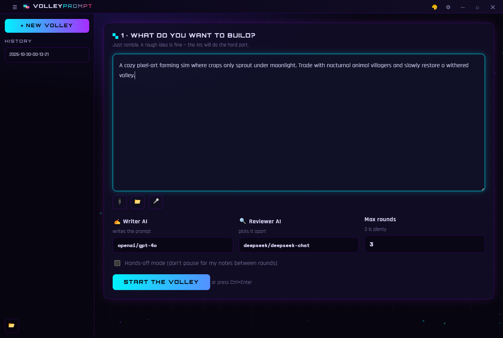
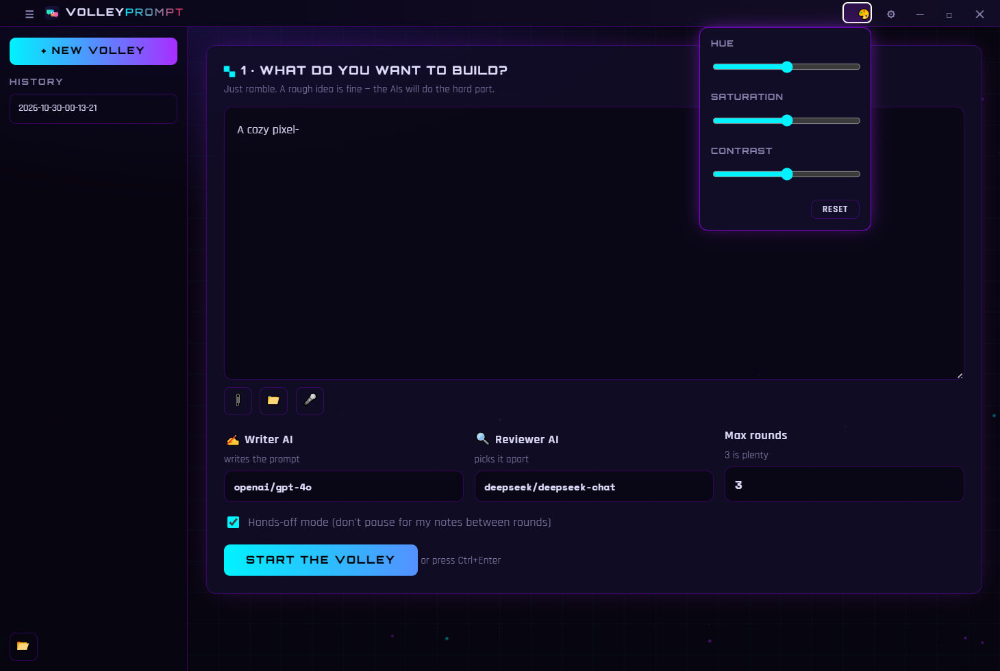

<div align="center">

# 🚀 VolleyPrompt

**Stop settling for mediocre AI responses. Let two AIs battle it out to make your prompt perfect.**

[](https://github.com/Chimthuwu/Volley-Prompt/releases/latest)
[](LICENSE)

<br />

> **The Problem:** You type a prompt into ChatGPT. The answer is... fine. But it's not great. So you rewrite the prompt, try again, and repeat. It's exhausting.
>
> **The Solution:** VolleyPrompt is a desktop app that uses **two different AIs**. One writes your prompt. The other ruthlessly critiques it. They "volley" it back and forth until it's absolutely flawless before you ever send it to a model.

</div>

---

### 📸 See it in action



*The composer: a big resizable editor, attach files/folders/images, dictate by voice, and tune the neon accent palette live from the titlebar.*

---

## ✨ Why people love VolleyPrompt

*   **🤖 The "Volley" Effect:** You pick a **Writer AI** (e.g., GPT-4o) and a **Reviewer AI** (e.g., DeepSeek). They iterate in rounds until the Reviewer actually *approves* the prompt.
*   **🖼️ "Here, look at this":** Don't just describe your UI. Paste a screenshot. Drop an image. Vision-capable models can literally see what you're talking about — VolleyPrompt checks the model supports it before sending, so you're never left guessing why a request failed.
*   **📁 Drop an entire folder, pick exactly what goes in:** Coding a project? Attach your source folder and the **Project Context Explorer** opens — a checkbox tree of every eligible file (junk like `node_modules`, `.git`, `dist`, lockfiles, `.env` and other secrets is filtered out automatically). Tick/untick individual files or whole subtrees, watch the selected-file count and estimated size update live, then attach just what the AI actually needs.
*   **🎙️ Just talk it out:** Don't feel like typing? Hit the microphone and ramble your idea. It transcribes straight into the editor at your cursor.
*   **🎨 Make it yours:** A hue/saturation/contrast panel in the titlebar retunes the whole neon accent palette live, and a collapsible sidebar gives the composer more room when you want it.
*   **⚡ Powered by OpenRouter:** Access models from OpenAI, Anthropic, Google, DeepSeek and more, all in one place — filtered to free/cheap/stealth models by default so you don't rack up a bill by accident.

---

## ⚙️ How it works

1. **You give it an idea.** (e.g., *"Write a prompt to build a snake game in Python."*)
2. **The Writer AI** generates the first draft of the prompt.
3. **The Reviewer AI** looks at it and says, *"This is too vague, add specific requirements for the snake's growth mechanics."*
4. **The Writer AI** rewrites it based on the critique.
5. **Repeat** for as many rounds as you choose (hands-off mode skips the pause between rounds).
6. **You copy the final, approved prompt** and paste it into your coding assistant.

---

### 🎨 Live theme tuning



Click the paint icon in the titlebar for hue/saturation/contrast sliders — they shift VolleyPrompt's actual accent colors (not a screen filter), and your preference is remembered next time you open the app.

---

## 🗺️ Roadmap

*   PDF text extraction (PDFs are currently detected and skipped with a clear notice).
*   Search/filter input in the Project Context Explorer to find files by name.

---

## 📦 Getting Started

### For regular users
1. Go to the **[Releases](https://github.com/Chimthuwu/Volley-Prompt/releases)** page.
2. Download the latest `VolleyPrompt - Windows Setup v<version>.exe`.
3. Install and launch the app.
4. Drop in your **OpenRouter API key** in Settings (the gear icon in the titlebar). Get one for free at [openrouter.ai](https://openrouter.ai).
5. Start volleying!

### For developers (running from source)

```bash
# 1. Clone the repository
git clone https://github.com/Chimthuwu/Volley-Prompt.git

# 2. Go into the folder
cd volleyprompt

# 3. Install dependencies
npm install

# 4. Launch the app
npm start
```

To build an installer yourself: `npm run dist` (Windows; see `package.json` for mac/Linux targets).

---

## 🔒 Privacy & security

- Your OpenRouter API key is encrypted at rest with the OS keychain (via Electron's `safeStorage`) and never leaves your machine except to call OpenRouter directly.
- Attachments stay local until you click Start — images, text files, and project folders are only sent once you submit, and run history on disk never stores attachment contents, only filenames.
- Folder ingestion never reads `.env` files, credentials, or anything outside an explicit source-file allowlist, and never executes code from a selected folder.

## 🛠️ Tech stack

Electron, vanilla JavaScript, HTML/CSS, and the [OpenRouter](https://openrouter.ai) API. No React, no Vue — just the DOM.

## License

MIT
